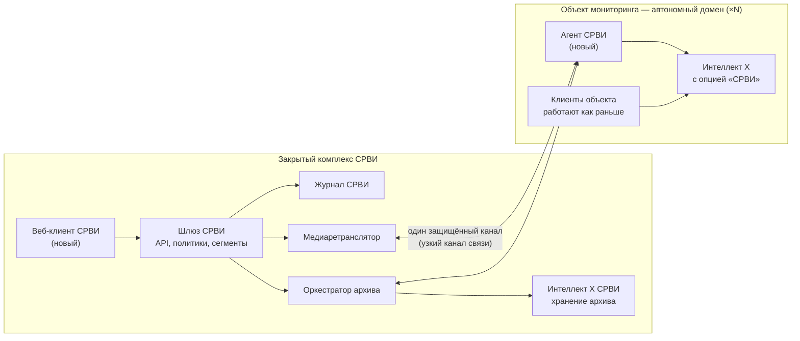

# СРВИ «Безопасный город» на «Интеллект X»: краткий анализ и предложение

*15.10.2026 · проект для обсуждения · подробности в [SafeCity_Specification.MD](SafeCity_Specification.MD)*

## Главное

- **Штатными средствами «Интеллект X» минимальный функционал СРВИ не закрывается.** Из 17 требований MVP семь не закрыты совсем, десять — частично.
- **Основной разрыв — перехват:** приоритетное отключение видео и архива другим пользователям, перенос архива в СРВИ, закрепление PTZ, подмена камеры в чужих раскладках. Второй разрыв — скрытие действий СРВИ от администраторов объектов. Эти функции требуют доработки ядра.
- **Предложение:** отдельный контур СРВИ с новым веб-клиентом и агентами на объектах, плюс доработки ядра под лицензионной опцией «СРВИ», выключенной по умолчанию. Текущие заказчики изменений не заметят.

## Что требует ТЗ (минимальный функционал)

ТЗ: `ТЗ_СРВИ_Безопасный_город.docx`, требования выделены жёлтым.

- **Изоляция.** СРВИ — отдельный сегмент со своими правами и журналом. Администраторы и операторы объектов не видят ни данных, ни действий СРВИ (п. 1.1, 1.2, 1.10, 1.22, 1.23).
- **Только веб.** Работа в браузере, без установки клиента: комплекс закрытый (п. 1.11).
- **Перехват** (п. 1.12–1.17):
  - отключить живое видео и архив пользователям с меньшими правами;
  - перенести фрагмент архива в СРВИ с закрытием на объекте и вернуть обратно;
  - приоритетно управлять PTZ с блокировкой остальных;
  - автоматически заменять перехваченную камеру в раскладках других пользователей.
- **Распределённость** (п. 1.18–1.21):
  - доступ к автономным объектам без объединения их в одну сеть;
  - по узким каналам передаются только камеры, открытые у операторов СРВИ;
  - резервирование и выборочная запись архива в СРВИ.
- **Данные** (п. 1.4): живое видео, архив и события видеоаналитики.

## Что умеет «Интеллект X» сейчас

| Область | Есть | Не хватает |
| --- | --- | --- |
| Веб-клиент | Видео, архив, PTZ, тревоги, экспорт, раскладки | Работает с одним доменом; функций СРВИ нет |
| API | HTTP, gRPC, WebSocket: камеры, видео, архив, права, PTZ-сессии | Нет запрета поверх ролей, нет управления чужими раскладками |
| Права | Роли, уровни доступа к камерам | Права ролей суммируются, запрета нет; архив закрывается только целиком |
| PTZ | 5 приоритетов, вытеснение | Нет уровня выше максимального и закрепления на срок; имя управляющего видно |
| Журнал | Системный журнал действий | Общий для всех с правом доступа; защиты от изменения нет |
| Распределённость | Cross-System клиент, ITV Cloud, ITV Datacenter, GreenStream | Общие учётные записи, нет приоритета, нет ретранслятора «один поток на объект» |
| Архив | Репликация внутри домена по камерам и периодам | Нет репликации в независимый домен, нет переноса со скрытием на источнике и возврата |

Итог по 17 требованиям MVP: семь **не закрыты** (п. 1.1, 1.12–1.15, 1.17, 1.23), десять закрыты **частично** (п. 1.2, 1.4, 1.10, 1.11, 1.16, 1.18–1.22).

## Предлагаемое решение

- **Контур СРВИ.** Все пользователи, права, сегменты и журнал СРВИ хранятся только здесь.
- **Агент СРВИ на объекте.** Единственная точка связи с СРВИ: один канал, сети не объединяются. Видео передаётся только по запросу, по одному потоку на камеру.
- **Доработки ядра «Интеллект X»** (включаются опцией «СРВИ»):
  - сервис ограничений — запрет доступа к живому видео, архиву и PTZ, который перекрывает ролевые права и действует, пока не истечёт срок;
  - вход агента по сертификату, невидимый для локальных администраторов, без записей в журнал объекта;
  - уровень приоритета PTZ выше максимального и закрепление управления на срок;
  - скрытие интервала архива, его импорт при возврате и репликация в независимый домен;
  - событие подмены камеры для клиентов.
- **Доработки клиентов объекта** минимальны и без функций СРВИ: временная подмена ячейки в раскладке и нейтральный статус «камера недоступна».

### Почему не другие варианты

- **Серверы СРВИ внутри доменов объектов.** Это объединяет сети (противоречит п. 1.18) и показывает СРВИ местным администраторам (п. 1.23).
- **Cross-System или ITV Datacenter без доработок.** Нужны одинаковые учётные записи на объектах, нет перехвата и приоритета, Cross-System — не веб-клиент.

## Веб-клиент: делаем новый

| | Доработать текущий | Новый клиент СРВИ |
| --- | --- | --- |
| Риск для текущих заказчиков | Высокий | Нет |
| Мультидоменность | Нет, один домен | Есть, через шлюз |
| Скрытие от объектов | Функции СРВИ оказались бы на серверах объектов | Клиент есть только в контуре СРВИ |
| Выпуск и аттестация | Вместе с продуктом | Независимо |
| Старт | Быстрее | Дольше, но плеер, шкалу времени и PTZ берём из текущего клиента |

Текущий веб-клиент раздаётся каждым сервером объекта, поэтому встраивать в него СРВИ — значит отдать функции СРВИ тем, от кого их надо скрыть.

## Этапы

| Этап | Что делаем | Требования |
| --- | --- | --- |
| 0 | Обследование: ITV Datacenter, Interop Driver, режим перехвата архива, требования ИБ | — |
| 1 | Каркас контура: шлюз, политики, журнал, агент, веб-клиент, живое видео, архив, события, ретранслятор | 1.1, 1.2, 1.4, 1.10, 1.11, 1.18, 1.19, 1.22 |
| 2 | Перехват видео и PTZ: доработки ядра и клиентов объекта | 1.12, 1.16, 1.17, 1.23 |
| 3 | Архив: перехват, возврат, резервирование, выборочная запись | 1.13–1.15, 1.20, 1.21 |
| 4 | Остальное ТЗ: реестр ведомств, ориентировки, адаптеры, подпись выгрузок | 1.3, 1.5–1.9 |

Этапы 1 и 2 можно вести параллельно: первый почти не касается ядра, второй — в основном ядро.

## Что нужно решить

1. **ITV Datacenter и Interop Driver.** Можно ли взять их за основу шлюза и межсистемной репликации? Это сильно влияет на объём работ, а публичной документации нет.
2. **Режим перехвата архива.** Скрывать фрагмент на объекте (возврат мгновенный, но фрагмент занимает место) или удалять (возврат требует обратной передачи)?
3. **Кто «с меньшими правами».** Все пользователи объекта, все кроме заданных ролей или пользователи ниже уровня приоритета?
4. **Что видят на объекте при перехвате.** Нейтральный статус могут принять за неисправность и вызвать обслуживание.
5. **Граница скрытия (п. 1.23).** Скрыть от администратора ОС сам факт подключения к СРВИ нельзя. Предлагаем зафиксировать в ТЗ трактовку «на уровне приложения».
6. **Масштаб и каналы.** Число объектов, камер, операторов СРВИ и пропускная способность каналов — для расчёта ретранслятора и хранилища.

*Анализ составлен по открытой документации ITV по «Интеллект X» 5.5/5.6. Часть страниц была недоступна, поэтому сведения об ITV Datacenter и Interop Driver нужно подтвердить у команды продукта.*
