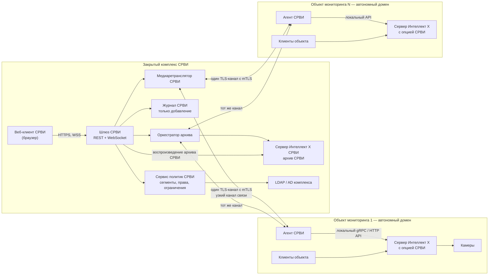
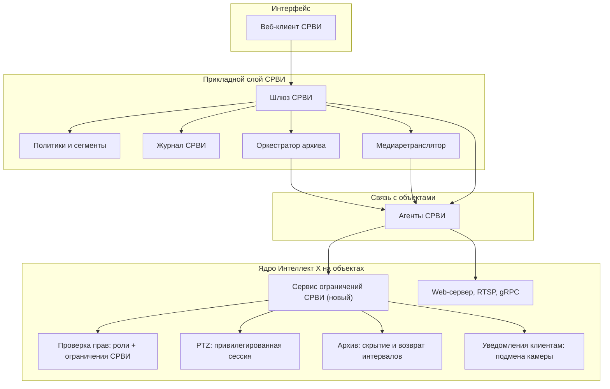
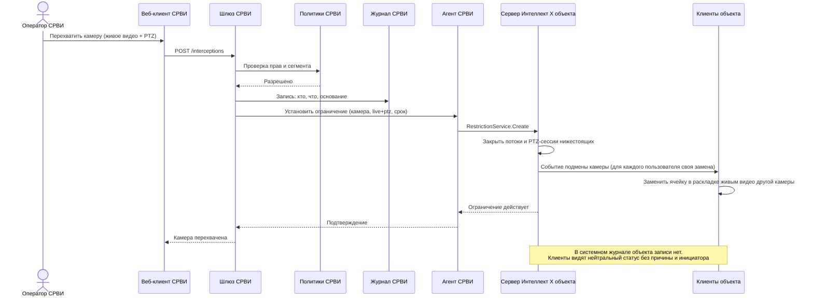
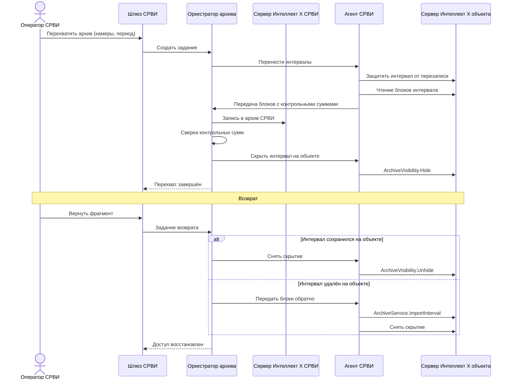

# СРВИ АПК «Безопасный город» на базе «Интеллект X»: требования и техническое решение

| | |
| --- | --- |
| Объект | Специальный раздел вычислительной инфраструктуры (СРВИ) АПК «Безопасный город» |
| Базовый продукт | «Интеллект X» (ITV), версии 5.5/5.6 |
| Вид документа | Функциональные требования и предлагаемое техническое решение |
| Источник требований | «ТЗ_СРВИ_Безопасный_город.docx» (Specifications) |
| Дата редакции | 15.10.2026 |
| Статус | Проект решения для обсуждения |

Документ состоит из трёх частей:

1. **Требования.** Структурированная редакция ТЗ на СРВИ с выделенным минимальным функционалом.
2. **Анализ продукта.** Что из требований «Интеллект X» закрывает сейчас, а что нет.
3. **Решение.** Архитектура, доработки ядра и API, решение по веб-клиенту, этапы и риски.

Предыдущая редакция этого файла описывала функциональные требования ко всему АПК «Безопасный город» (ГИС, поле зрения камер, ввод оборудования, облака). Она сохранена в истории git (коммит `749b0cc`) и в исходнике `БГ функциональные требования.docx`. Здесь эти разделы не повторяются.

## Термины и сокращения

| Термин | Значение |
| --- | --- |
| Система | Программное обеспечение АПК «Безопасный город» |
| СРВИ | Специальный раздел вычислительной инфраструктуры: изолированный сегмент для взаимодействия с правоохранительными и силовыми ведомствами |
| Контур СРВИ | Серверы, сервисы и рабочие места СРВИ в закрытом комплексе |
| Объект мониторинга | Удалённая автономная система видеонаблюдения (например, муниципальная) на базе «Интеллект X» |
| Подчинённая система | Система видеонаблюдения объекта мониторинга по отношению к СРВИ |
| Домен | Группа серверов «Интеллект X» с общей конфигурацией, пользователями и правами |
| Пользователь СРВИ | Оператор, администратор или аудитор контура СРВИ |
| Перехват камеры | Приоритетный захват живого видео, архива или PTZ-управления камерой пользователем СРВИ с отключением доступа пользователям с меньшими правами |
| Перехват архива | Перенос фрагмента архива на сервер СРВИ, после которого фрагмент становится недоступен на объекте |
| Ограничение СРВИ | Запись о запрете доступа к камере или фрагменту архива, которую устанавливает СРВИ. Действует поверх ролевых прав объекта |
| Раскладка | Набор окон видеонаблюдения на рабочем месте или на видеостене |
| PTZ-камера | Поворотная камера с изменением наклона и масштаба (pan-tilt-zoom) |
| ГРЗ | Государственный регистрационный знак |
| Агент СРВИ | Новый программный компонент на объекте мониторинга, через который СРВИ взаимодействует с подчинённой системой |
| Шлюз СРВИ | Новый серверный компонент контура СРВИ, который предоставляет API веб-клиенту СРВИ |

---

# Часть 1. Требования

Требование обязательно, если сформулировано через «должна» или «должен». Нумерация совпадает с ТЗ.

**Минимальный функционал (MVP)** — требования, выделенные в ТЗ жёлтым. Остальные требования относятся к следующим этапам.

## 1.1. Сводка

| № | Требование (кратко) | Группа | MVP |
| --- | --- | --- | --- |
| 1.1 | СРВИ — отдельный сегмент со своей моделью данных, настройками, правами и журналами | Изоляция | Да |
| 1.2 | Данные, настройки и журналы СРВИ не видны общему сегменту, включая его администраторов | Изоляция | Да |
| 1.3 | Реестр ведомств-потребителей | Ведомства | Нет |
| 1.4 | Видео, архив и события аналитики для ведомств | Данные | Частично |
| 1.5 | Списки контроля (ориентировки) | Ведомства | Нет |
| 1.6 | Адаптеры ведомственных систем | Ведомства | Нет |
| 1.7 | Контроль каналов обмена с ведомствами | Ведомства | Нет |
| 1.8 | Контрольная сумма, электронная подпись и метаданные выгрузок | Выгрузка | Нет |
| 1.9 | Неизменяемый журнал всех действий в СРВИ | Журнал | Нет |
| 1.10 | Журнал СРВИ доступен только уполномоченным лицам | Журнал | Да |
| 1.11 | Интерфейс СРВИ — только веб, без установки клиентского ПО | Интерфейс | Да |
| 1.12 | Приоритетный доступ к живому видео и его отключение нижестоящим | Перехват | Да |
| 1.13 | Приоритетный доступ к архиву и его отключение нижестоящим | Перехват | Да |
| 1.14 | Перехват архива: перенос фрагмента на сервер СРВИ с закрытием на источнике | Перехват | Да |
| 1.15 | Возврат перехваченного фрагмента с восстановлением доступа | Перехват | Да |
| 1.16 | Приоритетное управление PTZ с блокировкой нижестоящих | Перехват | Да |
| 1.17 | Автозамена перехваченной камеры в раскладках других пользователей | Перехват | Да |
| 1.18 | Бесшовный доступ к удалённым объектам без объединения их в одну сеть | Распределённость | Да |
| 1.19 | Передача по узким каналам только камер, выведенных на мониторы операторов СРВИ | Распределённость | Да |
| 1.20 | Резервирование архива подчинённых систем в СРВИ | Архив | Да |
| 1.21 | Выборочная запись архива в СРВИ по камерам и периодам | Архив | Да |
| 1.22 | Специализированные права и закрытые сегменты объектов внутри СРВИ | Права | Да |
| 1.23 | Администраторы и операторы подчинённых систем не видят действий СРВИ | Изоляция | Да |

В п. 1.4 к минимальному функционалу относятся живое видео, видеоархив и события видеоаналитики в реальном времени. Журналы проездов, результаты поиска и геоданные относятся к следующим этапам.

## 1.2. Минимальный функционал

### Изоляция сегмента

- **1.1.** Система должна реализовывать СРВИ как отдельный функциональный сегмент со своей моделью данных, настройками, правами доступа и журналами. Сегмент предназначен для информационного взаимодействия с правоохранительными и силовыми ведомствами.
- **1.2.** Данные, настройки и журналы СРВИ должны быть недоступны пользователям общего сегмента Системы, включая его администраторов, если у них нет прав в СРВИ.
- **1.10.** Просмотр журнала СРВИ должен быть доступен только уполномоченным лицам.
- **1.22.** Система должна позволять назначать группам пользователей СРВИ специализированные права доступа и выделять объекты видеонаблюдения в закрытые от других операторов сегменты СРВИ. Цель — не допустить неуполномоченных лиц к событиям, живому видео и архиву.
- **1.23.** Операторы и администраторы подчинённых систем видеонаблюдения не должны получать никаких данных о действиях операторов СРВИ, в том числе о перехвате живого видео, архива и управления PTZ-камерами.

### Данные для ведомств

- **1.4 (в части MVP).** Система должна предоставлять ведомствам через СРВИ:
  - живое видео и видеоархив с камер в объёме выданных прав;
  - события видеоаналитики в реальном времени: распознавание ГРЗ, детекция инцидентов и другие подключённые виды аналитики.

### Веб-интерфейс

- **1.11.** Пользовательский интерфейс СРВИ должен быть веб-интерфейсом. Он работает в браузере без установки клиентского ПО на рабочие места, поскольку СРВИ находится в закрытом комплексе.

### Приоритет и перехват

- **1.12.** Система должна обеспечивать пользователям СРВИ приоритетный доступ к живому видео с камер. Пользователь СРВИ с соответствующими правами должен иметь возможность отключить трансляцию живого видео с выбранных камер пользователям с меньшими правами доступа.
- **1.13.** Система должна обеспечивать пользователям СРВИ приоритетный доступ к видеоархиву камер. Пользователь СРВИ с соответствующими правами должен иметь возможность отключить доступ к архиву выбранных камер пользователям с меньшими правами доступа.
- **1.14.** Система должна обеспечивать перехват видеоархива, то есть перенос архива выбранных камер за заданный период на сервер СРВИ. После переноса перехваченный фрагмент на сервере системы видеонаблюдения должен становиться недоступным её пользователям.
- **1.15.** Система должна обеспечивать возврат перехваченного фрагмента с сервера СРВИ на сервер системы видеонаблюдения с восстановлением доступа к нему её пользователям.
- **1.16.** Система должна ограничивать или предоставлять пользователям СРВИ приоритетный доступ к управлению PTZ-камерами согласно их правам. Пока камерой управляет пользователь СРВИ, управление ею пользователями с меньшими правами должно блокироваться.
- **1.17.** При перехвате камеры пользователем СРВИ Система должна автоматически заменять эту камеру в раскладках остальных пользователей случайной доступной им камерой в режиме живого видео.

### Распределённость и архив

- **1.18.** Система должна обеспечивать бесшовный приоритетный доступ СРВИ к системам видеонаблюдения удалённых объектов мониторинга. Объекты сохраняют автономию и не объединяются в единую сеть.
- **1.19.** Система должна обеспечивать удалённый просмотр видео муниципальных объектов по узким каналам связи: живое и архивное видео передаётся только с тех камер, которые в данный момент выведены на мониторы операторов СРВИ.
- **1.20.** Система должна обеспечивать резервирование видеоархива систем видеонаблюдения в СРВИ.
- **1.21.** Система должна обеспечивать выборочную запись видеоархива удалённой системы видеонаблюдения в СРВИ по выбранным камерам и периодам.

## 1.3. Следующие этапы

- **1.3. Реестр ведомств-потребителей.** Для каждого ведомства указываются:
  - подразделения и ответственные лица;
  - основание подключения (соглашение, регламент);
  - перечень предоставляемых ресурсов и видов данных;
  - срок действия доступа.
- **1.4 (остальное).** Журналы проездов, результаты поиска по архиву, геоданные (расположение технических средств, поля зрения, геотреки).
- **1.5. Списки контроля (ориентировки).** Принимаются через API, из файлов и вручную. Учитываются срок действия, приоритет и получатели оповещений. О совпадениях оповещаются только уполномоченные пользователи ведомства-источника.
- **1.6. Адаптеры.** Обмен с ведомственными системами ведётся через настраиваемые адаптеры (шлюзы).
- **1.7. Контроль каналов обмена.** Контролируются доступность, задержки, объём переданных данных и ошибки. При нарушении обмена формируется оповещение.
- **1.8. Выгрузка видеоматериалов.** Для выгрузки формируются контрольная сумма, электронная подпись фрагмента и сопроводительные метаданные: камера, координаты, время начала и окончания, пользователь, основание.
- **1.9. Неизменяемый журнал.** Фиксируются все действия в СРВИ, в том числе просмотры видео, поисковые запросы, выгрузки, изменения прав и списков контроля.

Журнал СРВИ строится в MVP так, чтобы п. 1.9 закрывался без переделки: записи сразу хранятся в режиме «только добавление» с цепочкой хешей (см. часть 3).

---

# Часть 2. Анализ возможностей «Интеллект X»

Анализ составлен по открытой документации ITV по версиям 5.5/5.6 (docs.itvgroup.ru), PDF «SDK интеграции» и брошюре продукта. Часть фактов о закрытых или недоступных при проверке разделах (ITV Datacenter, Interop Driver) нужно подтвердить у команды продукта: они отмечены в разделе «Открытые вопросы».

## 2.1. Что есть в продукте

### Web-сервер

- **Развёртывание.** Встроен в сервер «Интеллект X» и запускается вместе с ним. На каждый сервер домена — свой Web-сервер. Отдельного кластера веб-серверов или балансировщика нет.
- **Порты и шифрование.** HTTP 80 (на Linux 8000), HTTPS 443 (TLS 1.2/1.3, сертификат в PEM), RTSP 554, RTSP поверх HTTP 8554.
- **Проксирование.** Web-сервер проксирует запросы ко всем серверам своего домена, в том числе gRPC (`POST /grpc`). Через NAT достаточно пробросить один порт.
- **Выдача видео:**
  - mp4 (H.264/H.265) — без перекодирования;
  - HLS — только H.264, без перекодирования;
  - MJPEG — по умолчанию;
  - RTSP;
  - WebM для архива;
  - перекодирование выключено по умолчанию. Всё, что не H.264, перекодируется в MJPEG — это большой трафик.
- **WebRTC и MSE** в документации не упоминаются.
- **Защита от перегрузки:** ограничение очереди запросов (ответ `503`) и статистика `/statistics/webserver`.

### Веб-клиент

- **Функции:**
  - живое видео и раскладки, в том числе распространение раскладок и временные раскладки;
  - управление PTZ;
  - просмотр и поиск в архиве;
  - тревоги всего домена;
  - экспорт;
  - закладки, интерактивная карта, события детекторов;
  - запуск готовых макрокоманд (создаются только в настольном клиенте);
  - статистика.
- **Технологии.** Одностраничное приложение, которое раздаёт Web-сервер. Внутри два плеера: MP4 и JPEG. Поддерживаются Chrome, Edge, Firefox и Safari.
- **Встраивание.** Видеокомпонент `embedded.html` встраивается через iframe и управляется через `postMessage` (команды `live`, `archive`, `setCamera`, `setTime` и другие).
- **Права.**
  - Вход в веб-интерфейс разрешает отдельное право роли.
  - Для пользователя задаются лимиты одновременных подключений (`web_count`, `mobile_count`).
- **Ограничения:**
  - клиент работает с одним доменом — с тем, к которому подключён Web-сервер;
  - конфигурирование системы (детекторы, архивы, пользователи) выполняется только в настольном клиенте;
  - сведений о замене брендинга (white-label) и о плагинах нет.

### API

- **HTTP API:**
  - камеры;
  - живое видео (`/live/media`);
  - архив (`/archive/list`, `/archive/contents/intervals`, `/archive/media`);
  - экспорт;
  - события, тревоги, системный журнал;
  - макрокоманды (`/macro/execute`);
  - PTZ-сессии.
- **WebSocket `/events`.** Состояние камер, тревоги, события детекторов, состояние записи.
- **gRPC** (через `POST /grpc` или порт 20109):
  - `AuthenticationService`, `DomainService`, `ConfigurationService`;
  - `ArchiveService`, `EventHistoryService`, `DomainNotifier.PullEvents` (в том числе события ГРЗ);
  - `SecurityService` (роли, пользователи, права на объекты и функции, LDAP);
  - `LayoutManager` (раскладки), `ExportService`, `LogicService` (макрокоманды).
- **Аутентификация.** Basic или Bearer-токен (`AuthenticateEx`). Анонимный доступ запрещён.
- **Клиентский HTTP API (порт 8888)** управляет раскладками только той рабочей станции, на которой запущен настольный клиент.

### Права и PTZ

- **Модель прав ролевая.**
  - Права нескольких ролей пользователя суммируются по самому широкому доступу. Явного запрета, перекрывающего разрешение, нет.
  - Уровни доступа к камере: от «Нет доступа» до «Реальное время/Архив/Управление/Настройка».
  - Доступ к архиву задаётся на уровне хранилища и глубины просмотра в часах, а не на интервал конкретной камеры.
- **PTZ.**
  - Пять уровней приоритета в роли. Пользователь с бо́льшим приоритетом вытесняет пользователя с меньшим.
  - Сессия захватывается через `/control/telemetry/session/acquire?session_priority=1..5`.
  - Блокировка держится, пока у пользователя выбрана камера, и снимается по бездействию (максимум 96 часов).
  - Имя управляющего показывается другим пользователям; показ можно отключить.
- **Системный журнал.**
  - Записываются входы, изменения конфигурации и прав, PTZ, экспорт, а в веб-клиенте — просмотр архива.
  - Журнал хранится локально на сервере, срок хранения от 0 до 1000 дней.
  - Право «Системный журнал» открывает действия всех пользователей.
  - Защиты от изменения нет.

### Распределённость и архив

- **Cross-System клиент.** Подключается к нескольким независимым доменам. Ограничения:
  - во всех доменах нужен одинаковый логин и пароль;
  - раскладки и права берутся из основного домена;
  - нужна лицензия уровня «Профессиональная» и выше.
- **ITV Cloud и ITV Datacenter.** Доступ к доменам без единой сети. ITV Datacenter поддерживает глобальные и доменные роли, но публично не документирован.
- **Экономия канала:**
  - многопоточность камер (высокий и низкий поток);
  - GreenStream — выбор потока под размер окна;
  - UDP multicast;
  - составной RTSP-поток (мозаика раскладки в одном потоке).
- **Репликация архива.**
  - Работает только внутри домена, с выбором камер.
  - Режимы «Всегда» и «По требованию» (вручную или макрокомандой «Начать репликацию» с длительностью и смещением).
  - В блочный архив записывает только в конец.
- **Interop Driver.** Синхронизирует архивы независимых систем «Интеллект X». Упоминается только в брошюре.
- **Защита и экспорт архива:**
  - защита от перезаписи закладками;
  - удаление части архива необратимо;
  - экспорт с цифровой подписью SHA-256 и паролем.

## 2.2. Соответствие требований MVP продукту

Оценка: **есть** — закрывается настройкой; **частично** — есть основа, нужна доработка; **нет** — функции нет.

| № | Требование | Состояние | Что есть в продукте | Чего не хватает |
| --- | --- | --- | --- | --- |
| 1.1 | Отдельный сегмент СРВИ | Нет | Домены, роли | Нет понятия СРВИ над множеством независимых доменов |
| 1.2 | Изоляция от общего сегмента | Частично | Отдельный домен для СРВИ | Изоляцию даёт только отдельный контур, не настройка подчинённых систем |
| 1.4 | Видео, архив, события аналитики | Частично | HTTP/gRPC API, WebSocket, события ГРЗ | Агрегация из многих доменов в один интерфейс |
| 1.10 | Доступ к журналу СРВИ | Частично | Право «Системный журнал» | Нужен собственный журнал СРВИ |
| 1.11 | Только веб | Частично | Веб-клиент одного домена | Нет мультидоменности, нет функций СРВИ |
| 1.12 | Отключение живого видео нижестоящим | Нет | Статичные права, «охрана в частном порядке» | Нет временного запрета, перекрывающего ролевые права |
| 1.13 | Отключение архива нижестоящим | Нет | Доступ на уровне хранилища и глубины | Нет запрета по камере и интервалу |
| 1.14 | Перехват архива | Нет | Репликация (копирование) внутри домена | Нет переноса между доменами и скрытия интервала на источнике |
| 1.15 | Возврат архива | Нет | — | Нет вставки интервала в середину блочного архива, нет снятия скрытия |
| 1.16 | Приоритетное управление PTZ | Частично | 5 приоритетов, захват сессии | Нет уровня выше максимального, нет закрепления на время, имя видно |
| 1.17 | Автозамена камеры в раскладках | Нет | Макрокоманды «Показать камеру», «Открыть раскладку» | Нет подмены ячейки в открытой раскладке |
| 1.18 | Доступ без объединения сетей | Частично | Cross-System, ITV Cloud, ITV Datacenter | Общие учётные данные, нет приоритета, нет веба |
| 1.19 | Узкие каналы | Частично | Многопоточность, GreenStream | Нет ретранслятора «один поток на объект», нет квот канала |
| 1.20 | Резервирование архива в СРВИ | Частично | Репликация внутри домена; Interop Driver | Нет репликации в независимый домен (документированной) |
| 1.21 | Выборочная запись в СРВИ | Частично | Камеры и периоды в макрокоманде репликации | То же, что в п. 1.20 |
| 1.22 | Сегменты внутри СРВИ | Частично | Роли и группы камер внутри домена | Нужна политика над множеством доменов |
| 1.23 | Скрытие действий СРВИ | Нет | Отключаемый показ имени PTZ-оператора | Все действия видны в журнале и конфигурации объекта |

**Вывод.** Готовыми средствами «Интеллект X» минимальный функционал не закрывается. Основная часть разрыва — в группе «Перехват» (п. 1.12–1.17) и в изоляции действий СРВИ (п. 1.23). Эти требования упираются в ядро продукта: проверку прав, PTZ, архив и клиентские раскладки. Внешней надстройкой их не решить. Транспорт, агрегацию объектов и интерфейс, наоборот, лучше делать отдельно от ядра, чтобы не затрагивать текущих пользователей.

---

# Часть 3. Техническое решение

## 3.1. Принципы

1. **Объект остаётся автономным.** Каждый объект мониторинга — свой домен «Интеллект X» со своими администраторами и пользователями. Серверы СРВИ в домены объектов не включаются, сети не объединяются (п. 1.18).
2. **Всё, что относится к СРВИ, живёт в контуре СРВИ.** Пользователи, права, сегменты, причины ограничений и журнал хранятся только в контуре СРВИ. На объекте хранится минимум: какое ограничение действует и до какого срока, без указания причины и инициатора (п. 1.2, 1.23).
3. **Ограничения СРВИ сильнее ролевых прав.** На объекте появляется новый слой проверки: ограничение СРВИ запрещает доступ, даже если роли пользователя его разрешают (п. 1.12, 1.13, 1.16).
4. **Новое отделено от существующего.** Доработки ядра включаются лицензионной опцией «СРВИ» и по умолчанию выключены. Текущие пользователи без этой опции не видят изменений в поведении продукта.
5. **Передаётся только то, что смотрят.** По каналу с объекта идут только потоки камер, открытых у операторов СРВИ. Каждый поток идёт один раз, независимо от числа зрителей (п. 1.19).

## 3.2. Рассмотренные варианты

| Вариант | Суть | Почему не подходит или подходит |
| --- | --- | --- |
| A. Серверы СРВИ в доменах объектов | Сервер СРВИ добавляется в домен каждого объекта, архив реплицируется штатно | Нарушает п. 1.18: объединение сетей. Нарушает п. 1.23: сервер СРВИ виден администраторам объекта в конфигурации. **Отклонён** |
| B. Cross-System клиент или ITV Datacenter без доработок | Операторы СРВИ подключаются к доменам объектов штатными средствами | Нужны одинаковые учётные записи на объектах — их видят локальные администраторы. Нет приоритета и перехвата. Cross-System — не веб-клиент. **Отклонён как самостоятельное решение** |
| C. Контур СРВИ с агентами на объектах и доработками ядра | Новый шлюз и веб-клиент в контуре СРВИ; агент СРВИ на каждом объекте; новый слой ограничений в ядре | Закрывает все требования MVP, не меняет поведение для текущих пользователей. **Рекомендуется** |

ITV Datacenter стоит оценить как основу для шлюза СРВИ: он уже объединяет независимые домены и поддерживает глобальные роли. Решение зависит от его фактической архитектуры, которая публично не описана (см. «Открытые вопросы»).

## 3.3. Архитектура

### Компоненты

**Контур СРВИ (закрытый комплекс)**

| Компонент | Назначение | Тип |
| --- | --- | --- |
| Веб-клиент СРВИ | Интерфейс операторов, администраторов и аудиторов СРВИ в браузере | Новый |
| Шлюз СРВИ | Единый API для веб-клиента: каталог объектов и камер, видео, архив, PTZ, перехват, события | Новый |
| Сервис политик СРВИ | Пользователи, группы и сегменты СРВИ (п. 1.22), атрибутные права, реестр действующих ограничений с причинами | Новый |
| Журнал СРВИ | Журнал всех действий СРВИ в режиме «только добавление» с цепочкой хешей; доступ только у роли «Аудитор СРВИ» (п. 1.10) | Новый |
| Медиаретранслятор СРВИ | Получает от объекта один поток на камеру и раздаёт его всем операторам СРВИ; управляет квотами канала | Новый |
| Оркестратор архива | Задания резервирования, выборочной записи, перехвата и возврата архива | Новый |
| Сервер «Интеллект X» СРВИ | Собственный домен СРВИ: хранит перехваченные и резервные архивы, отдаёт их на воспроизведение | Существующий продукт |
| Каталог пользователей | LDAP или AD закрытого комплекса для входа в СРВИ | Внешний |

**Объект мониторинга (автономный домен «Интеллект X»)**

| Компонент | Назначение | Тип |
| --- | --- | --- |
| Агент СРВИ | Единственная точка связи с СРВИ. Работает с локальным сервером через API, держит защищённый канал к контуру СРВИ, передаёт видео и архив, применяет ограничения | Новый |
| Сервер «Интеллект X» с опцией «СРВИ» | Применяет ограничения СРВИ, приоритет PTZ, скрытие интервалов архива, подмену камер в раскладках | Доработка ядра |
| Клиенты объекта (настольный, веб, мобильный) | Работают как раньше; при перехвате получают подмену камеры и нейтральный статус | Минимальная доработка |

### Схема развёртывания

С объектом СРВИ связан один защищённый канал через агента. Агент и сервер объекта не видят друг у друга ничего, кроме этого канала. Направление установления соединения (объект → СРВИ или СРВИ → объект) задаётся настройкой и согласуется со службой информационной безопасности комплекса.

### Логическая схема слоёв

## 3.4. Ключевые сценарии

### Перехват камеры (п. 1.12, 1.16, 1.17, 1.23)

### Перехват и возврат архива (п. 1.14, 1.15)

**Режимы перехвата архива:**

- **Скрытие (по умолчанию).** Фрагмент копируется в СРВИ, на объекте защищается от перезаписи по кольцу и скрывается от пользователей объекта. Возврат — снятие скрытия, мгновенно и без передачи данных. Минус: фрагмент занимает место на объекте.
- **Изъятие.** После копирования и сверки фрагмент удаляется на объекте. Возврат требует обратной передачи и вставки интервала в архив объекта (нужна доработка ядра — см. п. 3.6).

Выбор режима — решение заказчика. Возможно, оба режима нужны и выбираются для каждого перехвата.

### Просмотр по узкому каналу (п. 1.19)

1. Оператор открывает камеру объекта в раскладке веб-клиента СРВИ.
2. Шлюз запрашивает поток у медиаретранслятора.
3. Если этот поток уже идёт с объекта, ретранслятор раздаёт его новому зрителю. Если нет — запрашивает поток у агента объекта.
4. Агент берёт у локального сервера поток (низкий или высокий, в зависимости от размера окна и квоты канала объекта) и передаёт его в СРВИ.
5. Когда камеру закрыл последний зритель СРВИ, ретранслятор через короткую паузу закрывает поток с объекта.

Для архива действует то же правило: передаётся только воспроизводимый интервал. Для каждого объекта задаётся квота канала. При её превышении новые потоки идут в низком качестве, а оператор получает предупреждение.

### Резервирование и выборочная запись архива (п. 1.20, 1.21)

- **Резервирование:** постоянное задание по камерам объекта, с расписанием и ограничением скорости, чтобы не занимать узкий канал в рабочее время.
- **Выборочная запись:** разовое задание по выбранным камерам и периодам.
- **Обрыв канала:** агент продолжает с места разрыва; пропуски догружаются.
- **Отличие от перехвата:** архив объекта остаётся доступен его пользователям.

## 3.5. Решение по веб-клиенту

**Рекомендация: отдельный новый веб-клиент СРВИ.** Существующий веб-клиент «Интеллект X» не перерабатывается под СРВИ. Его общие модули (видеоплеер, временная шкала, управление PTZ) переиспользуются как библиотека компонентов.

| Критерий | Доработать текущий веб-клиент | Новый клиент СРВИ |
| --- | --- | --- |
| Риск для текущих пользователей | Высокий: изменения затрагивают всех заказчиков | Нет: текущий клиент не меняется |
| Модель данных | Один домен на один Web-сервер | Множество независимых объектов через шлюз СРВИ |
| Модель прав | Роли домена | Права и сегменты СРВИ над объектами |
| Размещение | На каждом сервере «Интеллект X» | Только в закрытом комплексе СРВИ |
| Функции СРВИ (перехват, журнал, сегменты) | Пришлось бы прятать за флагами в общем коде | Есть только в клиенте СРВИ |
| Цикл выпуска и сертификация | Привязан к релизам продукта | Независимый; удобнее аттестовать закрытый комплекс |
| Трудозатраты на старте | Ниже | Выше, но снижаются переиспользованием компонентов |

Доработать текущий веб-клиент неудобно и по другой причине: он раздаётся каждым сервером объекта. Функции СРВИ, заложенные в него даже в скрытом виде, оказались бы на объектах — у тех, от кого их нужно скрыть (п. 1.23).

**Доработки существующих клиентов «Интеллект X» всё равно нужны**, но они минимальные и не содержат функций СРВИ:

- обработка события подмены камеры: ячейка раскладки временно показывает другую камеру, а сохранённая раскладка не меняется (п. 1.17);
- нейтральный статус перехваченной камеры или интервала архива — без причины и инициатора (п. 1.23).

Доработки касаются настольного, веб- и мобильного клиентов. Они активны, только если на сервере включена опция «СРВИ».

**Технологии веб-клиента СРВИ** (предложение):

- одностраничное приложение на стеке текущего веб-клиента, чтобы переиспользовать компоненты;
- видео: mp4 через MSE (как в текущем плеере); WebRTC для живого видео стоит рассмотреть как вариант с меньшей задержкой;
- работа без внешних ресурсов (CDN, шрифты, карты из интернета), поскольку комплекс закрытый.

## 3.6. Доработки ядра «Интеллект X» и API

Все изменения включаются лицензионной опцией «СРВИ». Существующие методы API не меняют поведение, новые параметры необязательны.

### Ядро: новый сервис ограничений СРВИ

Новый gRPC-сервис на сервере объекта, например `axxonsoft.bl.srvi.RestrictionService`. Вызывать его может только привилегированный субъект СРВИ (см. ниже).

| Метод | Назначение |
| --- | --- |
| `CreateRestriction` | Установить ограничение: камера или группа камер; область (`LIVE`, `ARCHIVE`, `PTZ`); интервал для архива; кому запрещено (все, кроме СРВИ, или пользователи ниже заданного уровня); срок действия; непрозрачный идентификатор основания |
| `UpdateRestriction` | Продлить или изменить ограничение |
| `RemoveRestriction` | Снять ограничение и вернуть доступ |
| `ListRestrictions` | Список действующих ограничений (только для субъекта СРВИ) |

Требования к поведению:

- **Ограничение — запрет, а не право.** Оно проверяется после ролевых прав и перекрывает их.
- **Проверка во всех точках выдачи видео:** BL, Web-сервер, RTSP-сервер, экспорт, репликация, клиентский API. Открытые потоки и экспорты закрываются в момент установки ограничения.
- **Срок по часам сервера.** Ограничение снимается автоматически по истечении срока, даже если связь с СРВИ потеряна.
- **Хранение вне конфигурации домена.** Ограничения не видны в ролях и пользователях и не экспортируются с конфигурацией.

### Ядро: привилегированный субъект СРВИ

- **Аутентификация.** Агент СРВИ входит по сертификату (mTLS), выпущенному удостоверяющим центром СРВИ, а не по логину и паролю. Открытый ключ УЦ СРВИ задаётся при включении опции.
- **Невидимость для администраторов.**
  - Субъекта нет в списке пользователей объекта, локальный администратор не может его изменить.
  - Отключить опцию «СРВИ» можно, но это фиксируется и передаётся в СРВИ.
- **Журналирование.** Действия субъекта не пишутся в системный журнал объекта. Агент передаёт их в журнал СРВИ.

### Ядро: PTZ

- **Привилегированный уровень приоритета.**
  - В захвате сессии появляется уровень выше максимального: `session_priority=0` в HTTP API, аналогичное значение в gRPC.
  - Уровень доступен только субъекту СРВИ.
- **Ограничение с областью `PTZ`.** Закрепляет управление на заданный срок — независимо от выбора камеры в клиенте и от таймаута бездействия.
- **Скрытый владелец.** При такой сессии клиенты объекта видят нейтральный статус «Управление недоступно» без имени управляющего.

### Ядро: архив

| Изменение | Назначение |
| --- | --- |
| `ArchiveVisibility.Hide / Unhide` | Скрыть интервал камеры от пользователей объекта без удаления; вернуть доступ (п. 1.13–1.15) |
| Защита скрытого интервала от перезаписи | Скрытый интервал не стирается по кольцу до возврата или явного разрешения из СРВИ |
| `ArchiveService.ReadBlocks` | Потоковое чтение блоков интервала с контрольными суммами для передачи в СРВИ без перекодирования |
| `ArchiveService.ImportInterval` | Вставка интервала в архив объекта при возврате изъятого фрагмента; для блочного архива — через отдельный том возврата |
| Внешняя репликация | Репликация в другой домен через агента СРВИ. Возможная основа — Interop Driver (п. 1.20, 1.21) |

### Ядро и клиенты: подмена камеры в раскладках

- **Событие `camera_substitution`.** Новое событие в WebSocket `/events` и `DomainNotifier`. Содержит идентификатор перехваченной камеры и камеры-замены.
- **Выбор камеры-замены.** Её выбирает сервер отдельно для каждого пользователя: случайная доступная ему камера, которой ещё нет в его раскладке и которая не перехвачена.
- **Обработка в клиенте:**
  - клиент заменяет ячейку в отображаемой раскладке и переводит её в живое видео;
  - сохранённая раскладка не меняется;
  - при снятии ограничения клиент возвращает исходную камеру, если пользователь не изменил ячейку сам.
- **Отсутствие подходящей камеры.** Ячейка показывает нейтральное «Нет сигнала».

### Агент СРВИ: внутренний API

Агент — новый сервис, который ставится на объекте рядом с сервером «Интеллект X». С локальным сервером он работает через штатные и новые методы API. Наружу агент открывает один канал в контур СРВИ, по которому передаются:

- команды: ограничения, PTZ, задания архива;
- медиапотоки по запросу ретранслятора;
- блоки архива;
- события видеоаналитики, отфильтрованные по камерам, разрешённым СРВИ;
- телеметрия канала: доступность, задержка, загрузка;
- записи для журнала СРВИ.

Протокол — gRPC поверх TLS 1.3 с взаимной аутентификацией по сертификатам. Канал мультиплексирует команды и медиапотоки. Приоритет у команд, затем у живого видео, затем у архива.

### Шлюз СРВИ: внешний API для веб-клиента

| Ресурс | Методы | Назначение |
| --- | --- | --- |
| `/auth` | вход, продление, выход | Вход через каталог комплекса |
| `/sites` | список, состояние | Объекты мониторинга и состояние канала |
| `/cameras` | список, поиск, карточка | Камеры объектов с учётом прав и сегментов СРВИ |
| `/live/{camera}` | поток | Живое видео через медиаретранслятор |
| `/archive/{camera}` | интервалы, поток | Архив объекта или архив СРВИ |
| `/ptz/{camera}` | сессия, команды, пресеты | Приоритетное управление PTZ |
| `/restrictions` | создать, продлить, снять, список | Отключение живого видео и архива нижестоящим |
| `/interceptions` | создать, состояние, вернуть | Перехват камеры и архива |
| `/archive-jobs` | создать, расписание, состояние | Резервирование и выборочная запись |
| `/events` | WebSocket | События видеоаналитики, тревоги, состояние объектов |
| `/segments`, `/groups` | управление | Сегменты и группы пользователей СРВИ |
| `/audit` | поиск, выгрузка | Журнал СРВИ (только роль «Аудитор СРВИ») |

## 3.7. Безопасность и изоляция

- **Хранение данных СРВИ.** Пользователи, роли, сегменты, причины ограничений и журнал хранятся только в контуре СРВИ (п. 1.2).
- **Журнал СРВИ:**
  - ведётся в режиме «только добавление»;
  - каждая запись содержит хеш предыдущей; периодически журнал подписывается ключом СРВИ;
  - удалить или изменить запись средствами приложения нельзя;
  - это задел под п. 1.9.
- **Роли СРВИ:**
  - **оператор** — видео, архив, PTZ, перехват в своих сегментах;
  - **старший оператор** — отключение доступа нижестоящим, перехват архива;
  - **администратор** — объекты, сегменты, пользователи, без доступа к журналу;
  - **аудитор** — только журнал (п. 1.10, 1.22).
- **Что видит объект:**
  - нейтральные статусы без причины и инициатора;
  - в системном журнале объекта действий СРВИ нет (п. 1.23);
  - агент СРВИ виден на объекте как установленная служба.
- **Предел скрытия.** Полностью скрыть сам факт подключения к СРВИ от администратора операционной системы объекта нельзя. Требование п. 1.23 закрывается на уровне приложения: администраторы и операторы «Интеллект X» не получают данных о действиях СРВИ. Формулировку нужно согласовать с заказчиком.

## 3.8. Этапы реализации

| Этап | Состав | Требования |
| --- | --- | --- |
| 0. Обследование | Подтверждение с командой продукта возможностей ITV Datacenter и Interop Driver; выбор режима перехвата архива; согласование схемы канала со службой ИБ | — |
| 1. Каркас контура СРВИ | Шлюз, сервис политик, журнал СРВИ, агент СРВИ, веб-клиент: объекты, камеры, живое видео, архив объекта, события аналитики; медиаретранслятор | 1.1, 1.2, 1.4, 1.10, 1.11, 1.18, 1.19, 1.22 |
| 2. Перехват видео и PTZ | Сервис ограничений и привилегированный субъект в ядре; приоритет PTZ; подмена камеры и нейтральные статусы в клиентах объекта | 1.12, 1.16, 1.17, 1.23 |
| 3. Архив | Скрытие интервалов, чтение и импорт блоков, внешняя репликация, оркестратор архива; перехват, возврат, резервирование и выборочная запись | 1.13, 1.14, 1.15, 1.20, 1.21 |
| 4. Следующие этапы ТЗ | Реестр ведомств, ориентировки, адаптеры, контроль каналов, подпись выгрузок, полный неизменяемый журнал | 1.3, 1.5–1.9 |

Этапы 1 и 2 можно вести параллельно: этап 1 почти не затрагивает ядро, этап 2 — в основном доработки ядра.

## 3.9. Риски

| Риск | Последствие | Мера |
| --- | --- | --- |
| Изменения ядра затронут текущих заказчиков | Регрессии у пользователей без СРВИ | Лицензионная опция «СРВИ», выключенная по умолчанию; регрессионные тесты на конфигурациях без опции |
| На объектах разные версии «Интеллект X» | Старые версии не поддерживают сервис ограничений | Минимальная версия для подключения к СРВИ; до обновления объект доступен только для просмотра |
| Узкие каналы не вытянут архив | Резервирование растягивается на дни | Расписание, ограничение скорости, прореживание; приоритет живого видео над архивом |
| Перехват интервала в середине блочного архива | Возврат изъятого фрагмента сложен | Режим «скрытие» по умолчанию; том возврата для изъятых фрагментов |
| Нейтральный статус воспринимается как неисправность | Ложные заявки на обслуживание на объекте | Согласовать с заказчиком формулировку статуса и порядок для обслуживающих организаций |
| Скрытие от администратора ОС невозможно | Требование п. 1.23 трактуется шире, чем выполнимо | Зафиксировать трактовку «на уровне приложения» в ТЗ |

## 3.10. Открытые вопросы

1. **ITV Datacenter.** Можно ли использовать его как основу шлюза и сервиса политик СРВИ? Как он передаёт видео и хранит права? Публичной документации нет.
2. **Interop Driver.** Поддерживается ли он в 5.5/5.6? Можно ли на нём построить внешнюю репликацию в домен СРВИ?
3. **Режим перехвата архива.** Скрытие на объекте, изъятие или оба режима на выбор?
4. **Кто считается «пользователем с меньшими правами»** (п. 1.12, 1.13, 1.16)? Варианты: все пользователи объекта; все, кроме заданных ролей; пользователи ниже уровня приоритета.
5. **Что видят пользователи объекта при перехвате.** «Нет сигнала», «Камера недоступна» или ничего (только подмена камеры)? Как это согласуется с работой обслуживающих организаций?
6. **Направление соединения** между объектом и СРВИ и требования ИБ закрытого комплекса к каналу и сертификатам.
7. **Масштаб.** Число объектов, камер, одновременных операторов СРВИ и пропускная способность каналов — для расчёта ретранслятора и хранилища СРВИ.
8. **Минимальная версия «Интеллект X»** на объектах и порядок обновления.
9. **Лицензирование** опции «СРВИ» и агента.
